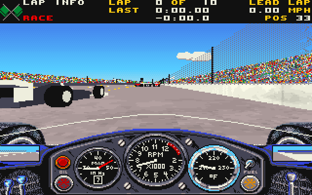
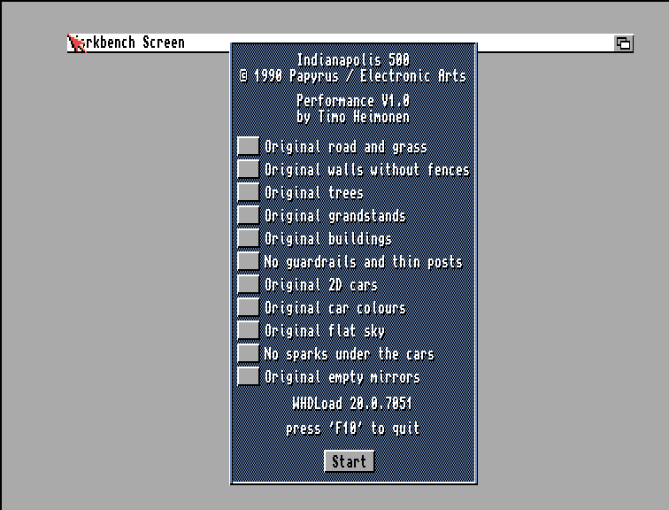

<!-- Indianapolis 500 WHDLoad Slave V1.0
Copyright (c) 2026 Timo Heimonen <timo.heimonen@proton.me>
Licensed under the MIT License. See the LICENSE file for details. -->

# Indianapolis 500 Performance WHDLoad patch

**Version 1.0.** Intended for emulator use (JIT, 68060) only.



A WHDLoad install of Indianapolis 500 (Papyrus / Electronic Arts, 1989;
Amiga 1990) that draws the 3D view at up to 50 frames per second in 256
colours:

- frames between the game's 15 simulation steps per second, so the view moves
  on every display frame while the driving model stays the original one;
- textured road, grass, walls with fences, grandstands with a crowd, trees
  and buildings, and a graded sky;
- 3D cars in team colours instead of the game's car images, sparks under
  them, and the track behind the car in the mirrors;
- the game runs from a hard drive: its own intro and loader are unchanged,
  disk access goes to a disk image and two save files.

Every group of graphics can be switched back to the original, before the
start or while driving ([Graphics options](#graphics-options)).

## Requirements

- An emulated Amiga with a 68060 and JIT, the AGA chipset, 2 MiB of Chip RAM
  and at least 4 MiB of Fast RAM. The game takes 512 KiB of Chip RAM and
  about 2.6 MiB of other memory; WHDLoad and the OS need the rest.
- Kickstart 3.1 and [WHDLoad](https://www.whdload.de/) 17 or later.
- Python 3 to write the install; no other packages and no
  assembler.
- The IPF image of the original disk (the TOSEC / SPS image; SHA-256 of
  its decoded sectors
  `3b0686e516934aabc35ff496c0e020d0e37fd4924a15106234f43188402aa08c`). ADF
  images are not accepted. The image is in the TOSEC Commodore Amiga
  collection (2012-04-10):
  <https://archive.org/details/Commodore_Amiga_TOSEC_2012_04_10>.

No game data, Kickstart ROM or WHDLoad executable is included.

## Install

With Python 3 on any computer, run the installer with your disk image:

```sh
python3 patch.py "Indianapolis 500.ipf" --output Indy500
```

It decodes the image, checks its content and creates the directory below and
its drawer icon beside it; copy both to the Amiga's hard drive. The image is
only read, and an existing directory or drawer icon stops the installer.

```text
Indy500.info        drawer icon, so that Workbench shows the drawer
Indy500/
  Indy500.slave
  Indy500.info      Workbench icon (default tool WHDLoad)
  Disk.1            the sectors of the game disk; the game only reads it
```

Start it from the icon or with:

```text
WHDLoad Indy500.slave PRELOAD NOWRITECACHE WRITEDELAY=10
```

Press F10 to quit from any screen.

## Graphics options



Each group of extras can be switched off: in WHDLoad's start window (tick
boxes), with `CUSTOM2=n` in the tool types or on the command line (n is the
sum of the values below), or with a key while the game runs.

| Value | Start window | Key |
|---|---|---|
| 1 | Original road and grass | Q |
| 2 | Original walls without fences | W |
| 4 | Original trees | E |
| 8 | Original grandstands | T |
| 16 | Original buildings | Y |
| 32 | No guardrails and thin posts | U |
| 64 | Original 2D cars | I |
| 128 | Original car colours | O |
| 256 | Original flat sky | A |
| 512 | No sparks under the cars | K |
| 1024 | Original empty mirrors | M |

The road and grass textures take the largest share of the drawing time, then
the walls and fences and the 3D cars; the sky and the car colours cost
nothing. The game's speed does not depend on the frame rate.

## Detail option

`CUSTOM1=n` (n = 1-39) makes the HIGH setting of the game's GRAPHICS DETAIL
menu draw less distant scenery: n replaces the game's limit 40. `CUSTOM1=20`
is a level between MEDIUM and HIGH: the grandstands stay, the clouds go.
Without the option, or with any other value, the limit is the game's own.

## Saves

The game's File menu works as on floppy. Car settings are stored in the file
`Settings` and the instant replay in the file `Replay`, both created in the
install directory on the first save. Until then the values on the disk image
are used, except that GRAPHICS DETAIL starts as HIGH (the disk has MEDIUM).
Delete a file to return to the disk's version.

## Building

`patch.py` uses the prebuilt `Indy500.slave` beside it. To build the slave
from the sources in `whdload/src` you need `vasmm68k_mot`:

```sh
python3 whdload/build.py --check
```

assembles every variant and writes nothing. Without the prebuilt slave
`patch.py` assembles the same one itself (`--interp --cpufill` of
`whdload/build.py`). Always build through `build.py`: it appends the table of
game addresses that the slave relocates to its memory. `slave.s` alone is a
plain WHDLoad slave of the game for a 68000; `interp.s` and `fill.s` include
the modules of the frames between steps and of the 256 colour view.

## Licence

MIT, see [LICENSE](LICENSE). Indianapolis 500 is copyright Papyrus Design Group
and Electronic Arts; this package contains none of its code or data.
